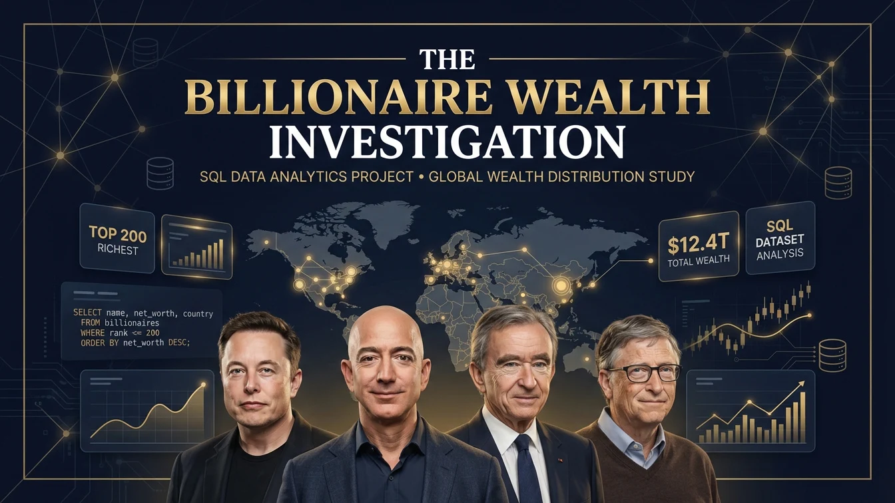
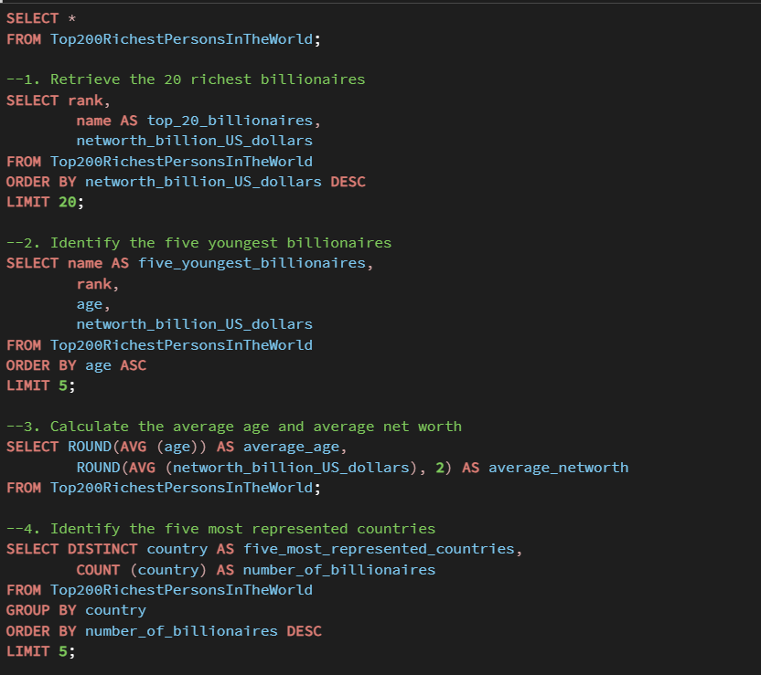
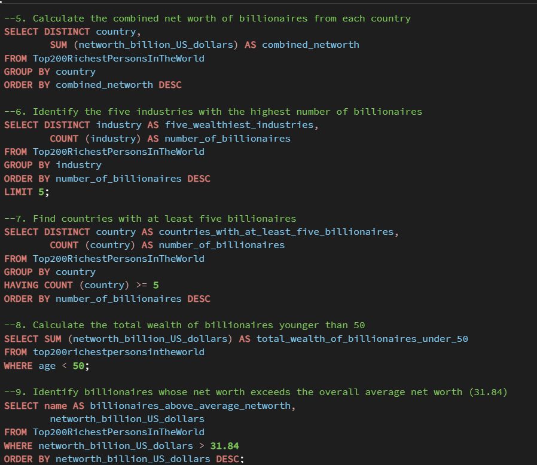
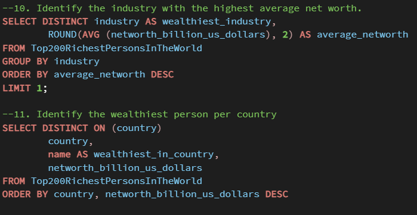

## **INTRODUCTION**

This project is my second individual project as a scholar in the Data Analytics Track of the second cohort of the FadaQa Tech Scholarship Programme (FSP2.0). FadaQa is a non-profit organisation that continues to empower and educate young individuals in the tech space by developing a growing community where these youths can be exposed to the relevant skills, opportunities, mentorship and the network they need to develop themselves, improve their financial and overall wellbeing, and drive useful innovations. As a beneficiary of the FadaQa Tech Scholarship Programme, I have been exposed and instructed on SQL and core data analytics technical skills, as well as soft skills; this project was completed in commitment to the programme as a requirement to demonstrate how much understanding has been gained.

## **ABOUT THE DATASET**

The Top 200 Richest World's Billionaires Dataset provides a detailed overview of the wealthiest individuals globally, according to the Forbes list, 2023. The dataset captures essential information about the top 200 billionaires, including their sequential numbering, global rank, full name, age, country of origin, net worth (in billions of dollars), and the primary industry or sector to which their wealth is attributed. It serves as a comprehensive resource for analysing global wealth concentration, demographic distribution, and sector dominance among the world's richest individuals.

## **PROBLEM STATEMENT**

A global financial research organisation wants to understand how extreme wealth is distributed among the world's 200 richest people. However, raw ranking tables alone do not clearly reveal how wealth is concentrated across different nations, age brackets, and economic sectors, or how individual outliers compare against global averages. Acting in the role of a Junior Data Analyst, this project queries and analyses the dataset using SQL to answer key business questions on geographic representation, demographic patterns, industry dominance, and country-level wealth leadership, enabling the organisation to extract structured, data-driven insights.

## **TOOLS & METHODOLOGY**

PostgreSQL (pgAdmin 4) was employed to clean, query, and analyse the dataset. Core SQL techniques — including aggregate functions ('COUNT', 'SUM', 'AVG'), filtering ('WHERE', 'HAVING'), grouping ('GROUP BY'), ordering ('ORDER BY')— were used to answer the core business questions as well as an additional exploratory query identifying the single richest individual in each country.

## **QUERIES**

## **INSIGHTS**

1. **Top 20 Richest Billionaires:** Querying the top tier of the global ranking highlights the extreme concentration of wealth at the very apex of the Forbes list, where the top 20 individuals account for a substantial share of the combined net worth of the entire top 200 cohort. The top 20 billionaires include:
- Bernard Arnault & family – $233.0B
- Elon Musk – $195.0B
- Jeff Bezos – $194.0B
- Mark Zuckerberg – $177.0B
- Larry Ellison – $141.0B
- Warren Buffett – $133.0B
- Bill Gates – $128.0B
- Steve Ballmer – $121.0B
- Mukesh Ambani – $116.0B
- Larry Page – $114.0B
- Sergey Brin – $110.0B
- Michael Bloomberg – $106.0B
- Amancio Ortega – $103.0B
- Carlos Slim Helu & family – $102.0B
- Francoise Bettencourt Meyers & family – $99.5B
- Michael Dell – $91.0B
- Gautam Adani – $84.0B
- Jim Walton & family	– $78.4B
- Rob Walton & family – $77.4B
- Jensen Huang – $77.0B
 
2. **Age Demographics and Younger Wealth Holders:** Evaluating the overall average age alongside the five youngest billionaires reveals the generational spread of global wealth. It is observed that although younger billionaires under 50 make up a substantial number, ultra-high-net-worth status is predominantly held by older founders and executive. The five youngest billionaires are:
- Mark Mateschitz (31) – $39.6B
- Lukas Walton	(37) – $28.0B
- Mark Zuckerberg	(39) – $177.0B
- Dustin Moskovitz (39) – $18.3B
- Pavel Durov (39) – $15.5B

3. **Global Average Billionaire Age and Net Worth:** Calculating the overall average net worth establishes a clear baseline of $31.84B across the 200 individuals with an average age of 69 years. 

4. **Geographic Representation vs. Combined Country Wealth:** Identifying the five most represented countries alongside nations with at least five billionaires illustrates where global wealth hubs are concentrated the United States shows more concentration with a significant 79 billionaires out of the 200, with China trailing behind with 17 billionaires. Aggregating the combined net worth by country further demonstrates that countries with high billionaire headcounts also command the largest pools of cumulative capital, though individual mega-fortunes can elevate smaller nations in total wealth rankings. The United States and France are typical examples; The United States has a the highest combined wealth ($3130.90B) owing to their high-representation. France on the other hand, trails behind ($478.80B), despite not being in the top 5 represented countries, due to the fact that the wealthiest individual (Bernard Arnault & family – $233.0B) is from the country. 

5. **Industry Dominance (Headcount vs. Average Net Worth):** Comparing the five industries with the highest number of billionaires against the industry with the highest average net worth highlights an important distinction between sector breadth and wealth intensity. While broad sectors like Technology and Finance & Investments attract the largest number of billionaires (40 and 32 billionaires respectively), the industry with the highest average net worth demonstrates where capital is most heavily concentrated per individual (Telecom – $102.00B).
Richest Person per Country: Extending the analysis beyond the core business questions to partition the dataset by country and isolate the highest-net-worth individual in each nation provides a granular view of national wealth leadership. The wealthiest man in Australia is Gina Rinehart with a networth of $30.80B despite ranking 56 on the global scale.

## **AREAS REQUIRING ATTENTION AND RECOMMENDATIONS FOR FURTHER ANALYSIS**

1. **Include Data on Wealth Source (Self-Made vs. Inherited):** While the dataset captures age, country, and industry, it does not distinguish between self-made entrepreneurs and inherited fortunes. Adding a wealth-origin indicator in future datasets would allow deeper analysis into generational wealth transfer, particularly among the youngest billionaires.

2. **Incorporate Year-over-Year Net Worth Changes:** Because the dataset represents a static snapshot of the Forbes list, it cannot show whether specific industries or countries are gaining or losing wealth over time. Tracking annual net worth growth rates would help financial researchers identify emerging high-growth sectors versus declining ones.

3. **Expand Coverage Beyond the Top 200:** Analysing only the top 200 billionaires naturally over-represents major economies and flagship industries. Expanding future datasets to the top 500 or 1,000 billionaires would provide broader visibility into emerging markets and mid-tier wealth distribution.

## **CONCLUSION**

This SQL investigation of the Top 200 Richest World's Billionaires dataset demonstrates that global billionaire wealth is unevenly distributed across geography, age, and industry. Headcount alone does not tell the full story: comparing total billionaire counts against combined net worth, industry averages, and above-average outliers reveals how heavily global wealth is skewed toward a select tier of individuals, nations, and high-value sectors.

Furthermore, isolating the richest individual per country adds critical context to national wealth totals by highlighting the specific leaders driving each nation's representation on the global stage. Combining structured aggregations with richer longitudinal and wealth-origin attributes in future analysis will enable global financial researchers to track shifting wealth dynamics with even greater precision.
